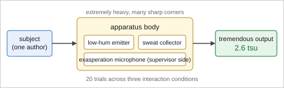
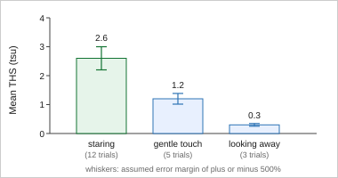

<!--
data/dummy/bhi-lint/main.md — BHI lint の受入フィクスチャ【不適合原稿】

data/dummy/bhi/main.md (適合原稿) の対になるダミー。**わざと規定に違反させてある**ので、
validate.py の各規則が期待どおり発火することを機械で確かめられる。

  docker compose -f docker/docker-compose.yml run --rm -u "$(id -u):$(id -g)" pandoc \
      python3 main/step05_package/validate.py \
          --input-root data/dummy/bhi-lint --journal bhi --article-type original

【内容は明らかなフィクション】
  適合原稿と同じ TJD/THS の物語である。**仕込んである違反は下の 26 種** (26. は ref.bib の側)
  (要修正 23 件 / 参考 4 件)。語数で発火する規則 (タイトル 39 語・図の題 20 語・表の題 18 語・
  凡例 305 語 / 304 語) は、その語数になるよう字面を合わせてある。

【仕込んである違反】(期待される指摘。→ は区分)
   1. タイトル 39 語 (上限 30)                                            → 要修正
   2. タイトル中の略語らしき全大文字語 (TJD / THS)                        → 参考
   3. 抄録の見出しラベルが 2 つ外れている (Objective ではなく Background /
      Conclusion ではなく Conclusions)                                    → 要修正
      ※ 1 つ目は Objective の代わりに Background、4 つ目は単数形の代わりに複数形で
        外れており、指摘は 2 ラベル分をまとめて挙げる
        (単数形と複数形の取り違えを弾く検証を兼ねている)
   4. 抄録の中に文献引用 [@yokan2099]                                     → 要修正
   5. キーワードが 2 語 (規定は 3〜5)                                     → 要修正
   6. Abbreviations 節が Introduction の【後ろ】にある                    → 要修正
   7. 記入欄 `<<...>>` が 2 箇所残っている                                → 要修正
   8. 合成 1 文字 ℃ を使っている                                         → 要修正
   9. 数値の桁区切りカンマ (12,000 / 1,200)                               → 要修正
  10. 非 SI 単位 (98.6 °F / 12 inches)                                    → 参考
  11. 統計ソフト SPSS にバージョンと製造元が無い                          → 参考
  12. 図の題が 20 語 (上限 15)                                            → 要修正
  13. 表の題が 18 語 (上限 15)                                            → 要修正
  14. 図の凡例が 305 語 (上限 300)                                        → 要修正
  15. 表の凡例が 304 語 (上限 300)                                        → 要修正
  16. 凡例の for="fig:nosuch" が原稿に存在しない                          → 要修正
  17. 凡例の for="tbl:perf" が直前の図 (fig:two) と食い違う               → 要修正
  18. 凡例に for 属性が無い (対象 fig:three には識別子がある)             → 参考
  19. 凡例の中身に箇条書きが入っている                                    → 要修正
  20. 凡例が本文段落の直後にある (直前に図・表が無い)                     → 要修正
  21. 図表が 9 点 (図 8 + 表 1。上限 8)                                   → 要修正
  22. Declarations の 6 項目のうち 2 つが無い                             → 要修正
  23. 連絡著者ブロックが 2 つある / 電話番号が無い                        → 要修正
  24. References の後ろに Appendix 節がある                               → 要修正
  25. 凡例を `(A)` で始めている (pandoc が番号つきリストとして読む)       → 要修正
      ※ 19. と同じ事故 (集約がそこで止まり本文に取り残される) を、
        箇条書きの記号を使わずに起こす形。実際の原稿で起きた
  26. 英語の文献 (ref.bib の chokkan2100) に langid = {english} がある  → 要修正
      ※ bhi.csl は langid があるだけで言語によらず "(in Japanese)" を付ける。
        書誌管理ソフト (Zotero / Better BibTeX など) の書き出しに多い形

【仕込んでいない違反】
  - **本文語数の超過** (Original Article 4,000 語) は入れていない。4,000 語の散文を
    フィクスチャに置くのは維持費に見合わないため。記事種別による上限の切替は
    `--article-type letter` (図表 1 点まで) を適合原稿 data/dummy/bhi に当てて確かめる。
  - **`.textbox` 内の図表** (上限の対象外になる図表の指摘) も入れていない。本ファイルは図表を
    すべて本文フローに置いており、箱の中の図表を足すと上の「図 8 + 表 1 = 9 点」の
    数え方が変わってしまう。この指摘の発火は data/dummy/regression/ で確かめる。

【注意】本ファイルは **lint を発火させるための原稿**である。ビルドは通るが (図と ref.bib を
  同梱してある)、成果物を提出物の見本として読まないこと。適合原稿の見本は data/dummy/bhi/。
-->

::: {custom-style="Title"}
TJD Based Quantification of the Tremendous Hunch Using the THS Dimensional Scale Together with a Cold Sweat Collection Subsystem and an Evaluation Across Three Interaction Conditions Performed by a Single Subject over Twenty Consecutive Trials in One Laboratory Room
:::

::: {custom-style="Author"}
Taro Yokan^1^, Hanako Chokkan^1,2^
:::

::: {custom-style="Affiliation"}
^1^Graduate School of Hunch Engineering, University of the Tremendous, Tremendo, Hunchshire, Fictionia

^2^Department of Intuition Informatics, Vibes Research Institute, Vibeston, Hunchshire, Fictionia
:::

::: {custom-style="Corresponding"}
**Corresponding author:** Taro Yokan

Graduate School of Hunch Engineering, University of the Tremendous, Tremendo, Hunchshire 000-0000, Fictionia

E-mail: yokan.taro@example.org
:::

::: {custom-style="Corresponding"}
**Corresponding author:** Hanako Chokkan

Department of Intuition Informatics, Vibes Research Institute, Vibeston, Hunchshire 000-0001, Fictionia

E-mail: chokkan.hanako@example.org
:::

::: {custom-style="Abstract"}
**Background:** The tremendous hunch is widely reported yet has never been measured, because no
instrument records it [@yokan2099].

**Methods:** We built an apparatus and defined a dimensional scale from its three outputs.

**Results:** Staring produced the highest mean score at 2.6 tremendous scale units.

**Conclusions:** The ordering of the three conditions is reproducible.
:::

::: {custom-style="Keywords"}
**Keywords:** Intuition; Psychophysics
:::

# Introduction

The tremendous hunch is reported often enough to need no defence as a phenomenon, yet no
instrument or scale has been described for measuring it [@chokkan2100]. We logged 12,000
samples over the trials and scored 1,200 sighs. The collection vials were stored at 20℃
throughout the study period.

<<Fill in the number of trials discarded because the professor left the room>>

{#fig:one}

::: {custom-style="Legend" for="fig:nosuch"}
Rectangles denote components and arrows denote the direction of measurement.
:::

# Abbreviations

THS, Totetsumonai Hyouka Scale; TJD, Totetsumonai Jikken Device; tsu, tremendous scale unit.

# Methods

Trials were run on consecutive afternoons. The reference standard was the subject's own report.
Statistical analysis used SPSS. The threshold for significance was five percent throughout, and
no adjustment for multiple comparisons was applied at any stage of the reported analysis.

The bench that carried the apparatus was held at 98.6 °F, and the apparatus occupied 12 inches
of bench depth in the laboratory room.

<<Describe the hardware used for the exasperation microphone>>

{#fig:two}

::: {custom-style="Legend" for="tbl:perf"}
Bars show the mean score for each of the three interaction conditions.
:::

{#fig:three}

::: {custom-style="Legend"}
Counts are pooled over all twenty trials.
:::

{#fig:four}

::: {custom-style="Legend" for="fig:four"}
Agreement is reported separately for the two scoring passes:

- first pass, before the short break;
- second pass, after the short break.
:::

{#fig:five}

::: {custom-style="Legend" for="fig:five"}
Curves show the exasperation score.
This padding sentence exists only to push the legend past the three hundred word limit.
This padding sentence exists only to push the legend past the three hundred word limit.
This padding sentence exists only to push the legend past the three hundred word limit.
This padding sentence exists only to push the legend past the three hundred word limit.
This padding sentence exists only to push the legend past the three hundred word limit.
This padding sentence exists only to push the legend past the three hundred word limit.
This padding sentence exists only to push the legend past the three hundred word limit.
This padding sentence exists only to push the legend past the three hundred word limit.
This padding sentence exists only to push the legend past the three hundred word limit.
This padding sentence exists only to push the legend past the three hundred word limit.
This padding sentence exists only to push the legend past the three hundred word limit.
This padding sentence exists only to push the legend past the three hundred word limit.
This padding sentence exists only to push the legend past the three hundred word limit.
This padding sentence exists only to push the legend past the three hundred word limit.
This padding sentence exists only to push the legend past the three hundred word limit.
This padding sentence exists only to push the legend past the three hundred word limit.
This padding sentence exists only to push the legend past the three hundred word limit.
This padding sentence exists only to push the legend past the three hundred word limit.
This padding sentence exists only to push the legend past the three hundred word limit.
This padding sentence exists only to push the legend past the three hundred word limit.
:::

# Results

: Mean score for each of the three interaction conditions measured across twenty consecutive trials in one laboratory room {#tbl:perf}

| Condition     | Trials | Mean THS (tsu) |
|:--------------|-------:|---------------:|
| Staring       |     12 |            2.6 |
| Gentle touch  |      5 |            1.2 |

::: {custom-style="Legend" for="tbl:perf"}
Values are provisional means.
This padding sentence exists only to push the legend past the three hundred word limit.
This padding sentence exists only to push the legend past the three hundred word limit.
This padding sentence exists only to push the legend past the three hundred word limit.
This padding sentence exists only to push the legend past the three hundred word limit.
This padding sentence exists only to push the legend past the three hundred word limit.
This padding sentence exists only to push the legend past the three hundred word limit.
This padding sentence exists only to push the legend past the three hundred word limit.
This padding sentence exists only to push the legend past the three hundred word limit.
This padding sentence exists only to push the legend past the three hundred word limit.
This padding sentence exists only to push the legend past the three hundred word limit.
This padding sentence exists only to push the legend past the three hundred word limit.
This padding sentence exists only to push the legend past the three hundred word limit.
This padding sentence exists only to push the legend past the three hundred word limit.
This padding sentence exists only to push the legend past the three hundred word limit.
This padding sentence exists only to push the legend past the three hundred word limit.
This padding sentence exists only to push the legend past the three hundred word limit.
This padding sentence exists only to push the legend past the three hundred word limit.
This padding sentence exists only to push the legend past the three hundred word limit.
This padding sentence exists only to push the legend past the three hundred word limit.
This padding sentence exists only to push the legend past the three hundred word limit.
:::

{#fig:six}

::: {custom-style="Legend" for="fig:six"}
(A) Trials discarded because the professor left the room. (B) Trials discarded for other causes.
:::

{#fig:seven}

{#fig:eight}

# Discussion

The ordering held in every trial, and the dominant source of error was the exasperation term
rather than the sensors [@dan2099].

::: {custom-style="Legend" for="fig:eight"}
This legend is separated from its figure by a paragraph of body text, so the final package
cannot tell which float it belongs to.
:::

# Conclusion

The apparatus and the scale together order the three conditions reproducibly.

# Declarations

## Funding

The authors received no specific funding for this work.

## Authors' contributions

T.Y.: Conceptualization, Methodology. H.C.: Data curation, Software. All authors read and
approved the final manuscript, and agree to be accountable for all aspects of the work.

## Data availability statement

The trial logs are fictional and are distributed with the manuscript template.

## Competing interests

The authors declare that they have no competing interests.

# References

::: {#refs}
:::

# Appendix

This appendix is placed after References on purpose, which breaks the assumption that the
figure legends and the tables moved to the end of the file land immediately after References.
