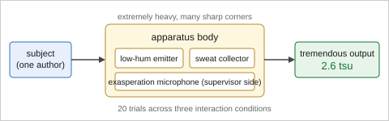
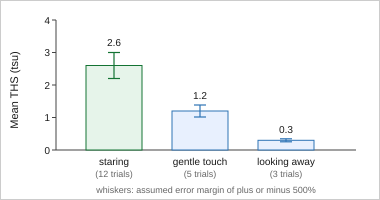

<!--
data/dummy/bhi/main.md — BHI 骨格の検証用ダミー原稿

data/journals/bhi/skeleton/main.md の記入欄を埋めた【完結サンプル】。骨格が実際にビルドでき、
節順が規定どおりに出ることを機械で確認するための入力である。

  bash scripts/build.sh --journal bhi --article-type original --input data/dummy/bhi

【内容は明らかなフィクション (パロディ)】
  「とてつもない予感」を装置と尺度で定量する、という TJD / THS の物語である。
  出典は https://github.com/fk506cni/jami-pandoc-public の src/paper.md (サンプル詳細抄録)。
  **なぜフィクションか**: 実在しそうな体裁 (実在の機関・本物らしい著者名や ORCID の形式) の
  ダミーは、本番原稿に混じったときに気づきにくく、逆に「これはダミーだ」と分かる必要がある
  場面で分からない。TJD/THS は明らかなフィクションなので取り違えが起きない。
  実在の機関名・実在の形式の ORCID・実在の統計ソフトの
  バージョンは書いていない (下の各所の注記を参照)。

【なぜ data/dummy/ 直下ではなく data/dummy/bhi/ なのか】
  data/dummy/main.md は雑誌非依存の回帰フィクスチャで、雑誌非依存の全要素 (textbox /
  grid 表 / 数式 / Mermaid 図 / PDF 図) を通すために作られている。これを BHI 骨格へ拡張すると
  雑誌非依存の回帰を確かめる役目と衝突するため、別ディレクトリにした。
  入力ルートは .development の有無だけで data/dummy / src に決まるので、本ディレクトリを使う
  コマンドは【必ず --input data/dummy/bhi を明示する】こと。

【骨格との対応】
  Title page (Title/Author/Affiliation/Corresponding) → Abstract → Abbreviations → Introduction
  → Methods → Results → Discussion → Conclusion → Acknowledgements → Declarations → References。
  Acknowledgements は AI 使用開示の見本 (下の節のコメントを参照)。
  図表は本文中の自然な位置に置く (末尾移設と Figure Legends 集約は package の仕事)。
  本ファイルは BHI 規定に【適合した】見本である。validate を掛けても指摘は出ない
  (要修正 0 件・参考 0 件)。わざと違反させた対のフィクスチャは data/dummy/bhi-lint/ にある。
  図表の題はキャプション、凡例は直後の custom-style="Legend" Div に書く
  (CLAUDE.md 「図表の題と凡例の書き分け」)。
-->

::: {custom-style="Title"}
Quantifying the Tremendous Hunch with a Purpose-Built Apparatus and a New Dimensional Scale
:::

<!-- ORCID iD は規定上「あれば」書くもの ("if they have")。ここに置いた 2 つの値は
     **検査数字 (ISO 7064 MOD 11-2) を満たさないので、ORCID が発行することはありえない** —
     先頭 15 桁が 999999999999999 のときの正しい末尾は 4 で、1 でも 2 でもない
     (「9999- は ORCID が発行していない範囲」という理由づけは割り当て方針の話で
     将来変わりうるが、検査数字は規則なので変わらない)。
     実在の研究者に解決する値をダミーに書かないための措置。
     3 人目は「iD を持たない著者」の書き方の見本。 -->
::: {custom-style="Author"}
Taro Yokan^1^ (ORCID: 9999-9999-9999-9991), Hanako Chokkan^2^ (ORCID: 9999-9999-9999-9992), Bonta Dan^1^
:::

::: {custom-style="Affiliation"}
^1^Graduate School of Hunch Engineering, University of the Tremendous, Tremendo, Hunchshire, Fictionia

^2^Department of Intuition Informatics, Vibes Research Institute, Vibeston, Hunchshire, Fictionia
:::

::: {custom-style="Corresponding"}
**Corresponding author:** Taro Yokan

Graduate School of Hunch Engineering, University of the Tremendous

1-1 Tremendous Avenue, Tremendo, Hunchshire 000-0000, Fictionia

Tel: +00-0-0000-0000

E-mail: yokan.taro@example.org
:::

::: {custom-style="Abstract"}
**Objective:** The tremendous hunch felt on waking is widely reported yet has never been
measured, because no instrument records it and no scale expresses it. We asked whether a
purpose-built apparatus and a new dimensional scale can order three interaction conditions
reproducibly, and whether the ordering survives an error margin large enough to be honest
about.

**Methods:** We built the Totetsumonai Jikken Device, an apparatus that logs hunch intensity,
cold-sweat volume, and the supervising professor's degree of exasperation. From these three
quantities we defined the Totetsumonai Hyouka Scale, whose unit is the tremendous scale unit.
A single subject performed 20 trials across three predefined interaction conditions: staring,
gentle touch, and looking away. The apparatus recorded 12 000 samples in total. Because the
measurement of exasperation is inherently unstable, an error margin of plus or minus 500% is
assumed throughout, and conditions were compared by their mean ordering rather than by formal
significance testing.

**Results:** Staring produced the highest mean score at 2.6 tremendous scale units, followed
by gentle touch at 1.2 and looking away at 0.3. The ordering held in every one of the 20
trials, whereas the absolute values did not: the interquartile range of the exasperation term
spanned an order of magnitude, and it dominated the propagated error. Cold-sweat volume was
the only component that the apparatus recorded without operator intervention.

**Conclusion:** The apparatus and the scale together yield a reproducible ordering of the
three conditions, while the absolute magnitude of the tremendous hunch remains gloriously
inconclusive. Standardising the exasperation term, perhaps with a calibrated sigh detector, is
the limiting step.
:::

::: {custom-style="Keywords"}
**Keywords:** Intuition; Psychophysics; Equipment Design; Research Design; Reproducibility of Results
:::

# Abbreviations

IQR, interquartile range; THS, Totetsumonai Hyouka Scale; TJD, Totetsumonai Jikken Device;
tsu, tremendous scale unit.

# Introduction

The hunch that arrives on waking — "this is a research project with a tremendous hunch" — is
reported often enough that it needs no defence as a phenomenon, yet it has never been
measured [@yokan2099]. Conventional research proceeds from a hypothesis; the present work
proceeds solely from a hunch, which we consider groundbreaking.

Despite the ubiquity of the experience, no instrument or scale has been described for
measuring a hunch. The prior accounts we could find are limited to informal testimony
gathered at a drinking party, where respondents rated the study as unprecedented and the first
author as possibly overtired [@chokkan2100]. A dimensional treatment of the accompanying cold
sweat has been proposed, but it stops short of an instrument [@dan2099].

We therefore built an apparatus and defined a scale, and asked two questions: whether the
scale orders three interaction conditions consistently, and whether that ordering survives the
error introduced by the least controllable of its three input quantities.

# Methods

## Study design and subject

This was a descriptive, single-subject study. The sole subject, the first author, performed 20
trials across three predefined interaction conditions with the apparatus: staring, gentle
touch, and looking away. No ethics review was applicable, because the study involves neither
human samples nor patient data; it involves only a tremendous hunch.

## The apparatus

To convert the hunch into a physical quantity we built the TJD, shown in [@fig:apparatus]. The
device is extremely heavy and has many sharp corners, so its merits are difficult to argue
using ordinary indicators such as portability or safety. On startup it emits a low hum and
renders the surrounding air vaguely oppressive. Cold sweat is drawn into collection vials held
at 4 °C; the supervisor's exasperation is picked up by a microphone on the far side of the
bench.

{#fig:apparatus}

::: {custom-style="Legend" for="fig:apparatus"}
Rectangles denote components and arrows denote the direction of measurement. The subject sits
at the left, the apparatus body carries the three sensors, and the tremendous output display
at the right shows the score for the current trial. The low-hum emitter is not a sensor; it is
retained because removing it lowered the reported hunch intensity in pilot runs. THS,
Totetsumonai Hyouka Scale; TJD, Totetsumonai Jikken Device; tsu, tremendous scale unit.
:::

## The scale

The International System of Units cannot describe the tremendousness of this study. We
therefore defined the THS from hunch intensity $P$, cold-sweat volume $S$, and the
supervisor's degree of exasperation $A$, as $\mathrm{THS} = P \times S / A^{2}$. The unit is
the tsu. Placing exasperation in the denominator, and squaring it, is deliberate: a supervisor
who is entirely unmoved makes any hunch look tremendous, and we wanted that property to be
visible in the formula rather than buried in the discussion.

## Outcome measures and analysis

For each condition we aggregated the number of trials and computed the mean THS. Continuous
quantities are reported as medians with IQRs. Because the measurement of exasperation is
inherently unstable, an error margin of plus or minus 500% is assumed throughout, and
conditions were compared by their mean ordering rather than by formal significance testing.
The apparatus logged 12 000 samples over the 20 trials. Analyses were performed using R
version 99.9 (Tremendous Statistical Foundation, Tremendo, Hunchshire, Fictionia), a release
number chosen to make clear that this manuscript is a fixture and not a study.

# Results

## Trials and conditions

All 20 planned trials were completed and none was excluded. Staring accounted for 12 trials,
gentle touch for 5, and looking away for 3; the imbalance follows the subject's own preference
and was not randomised.

## Scores by condition

The mean THS by condition is given in [@tbl:conditions] and shown in [@fig:ths]. Staring
yielded the highest score, consistent with the intuition that one should look directly at the
target to heighten a hunch.

: Mean score for each of the three interaction conditions. {#tbl:conditions}

| Condition     | Trials | Mean THS (tsu) |
|:--------------|-------:|---------------:|
| Staring       |     12 |            2.6 |
| Gentle touch  |      5 |            1.2 |
| Looking away  |      3 |            0.3 |

::: {custom-style="Legend" for="tbl:conditions"}
Values are arithmetic means over the trials in each condition, carrying the assumed error
margin of plus or minus 500%. The three conditions are mutually exclusive and together account
for all 20 trials. THS, Totetsumonai Hyouka Scale; tsu, tremendous scale unit.
:::

## Stability of the ordering

The ordering staring > gentle touch > looking away held in every one of the 20 trials, whereas
the absolute values did not. The IQR of the exasperation term spanned an order of magnitude
and dominated the propagated error, as shown by the whiskers in [@fig:ths].

{#fig:ths}

::: {custom-style="Legend" for="fig:ths"}
Bars show the mean score for each condition and whiskers show the assumed error margin of plus
or minus 500%. Condition labels carry the number of trials contributing to each bar.

The whiskers are not confidence intervals: they are a fixed proportional margin adopted because
the exasperation term could not be calibrated. This legend is deliberately split into two
paragraphs so that the legend aggregation step is exercised on a multi-paragraph legend (a legend
may run to 300 words, so authors do split it). THS, Totetsumonai Hyouka Scale; tsu, tremendous
scale unit.
:::

Cold-sweat volume was the only one of the three inputs that the apparatus recorded without
operator intervention; hunch intensity was self-reported and exasperation was scored by a
listener.

# Discussion

The results place staring at the top of the ordering, which agrees with the informal testimony
collected earlier [@chokkan2100] and with the directness intuition that motivated the study.
The finding that matters, however, is not the ordering itself but its stability: the ordering
survived in all 20 trials while the absolute scores moved by an order of magnitude between
them. A scale can be useful for ranking long before it is useful for measurement.

The dominant source of error was not the apparatus but the third input. Exasperation was
scored by a listener, and squaring it in the denominator amplifies whatever noise that scoring
carries. Standardising this term — a calibrated sigh detector is the obvious candidate — would
do more for the scale than any improvement to the sensors, and the same argument applies to any
composite index that mixes instrumented and human-scored quantities [@dan2099].

This study has three limitations. It used a single subject, so what is embedded in both the
design and the interpretation is one person's hunch. The number of trials per condition follows
the subject's preference rather than a randomisation schedule, so the conditions are not
balanced. Finally, we evaluated the ordering, not any downstream consequence of knowing it,
which is what would ultimately justify building a second apparatus.

# Conclusion

The apparatus and the scale together produced a reproducible ordering of three interaction
conditions — staring at 2.6, gentle touch at 1.2, and looking away at 0.3 tsu — that held in
every trial. The absolute magnitude of the tremendous hunch remains gloriously inconclusive.
Standardising the exasperation term is the most promising next step.

# Acknowledgements

We thank Mushi Shirase for calibrating the sigh detector, a contribution that does not meet the
criteria for authorship.

The authors used HunchWriter (version 0.0, Vibes Research Institute), a generative AI tool, to
suggest the order of the sections and to check spelling and grammar. The tool was not used to
collect or analyse data, or to generate any figures. The authors reviewed and edited all output
and take full responsibility for the entire content of the submitted manuscript. The final
manuscript was also reviewed by a native English speaker.

<!-- Acknowledgements 節 (骨格 data/journals/bhi/skeleton/main.md の
     Acknowledgments 節を埋めた見本)。
     - 【節名の綴り】本動作例は英式で書いてある (randomised / labelled / Standardising) ので、
       節名も英式の Acknowledgements にした。骨格は本誌の用例に合わせて米式の Acknowledgments。
       規定が求めるのは「米式/英式のどちらかに統一」だけである (docs/journal-bhi.md §14.3)。
     - 【AI 使用開示の 5 要素】ツール名 / 版 / 使途 / 著者が全内容に責任を負う旨 / ネイティブによる
       最終確認 (文例は data/journals/bhi/skeleton/declarations.md §7)。版だけは規定の要求ではなく
       本テンプレの上乗せ。
     - HunchWriter は架空の道具で、版 0.0 も架空 (実在の製品名・版を動作例に書かない方針。
       上の冒頭コメントを参照)。所属は第 2 著者の架空の機関を流用した。
     - 1 段落目は「オーサーシップの 4 基準を満たさない貢献者」への謝辞の見本 (任意)。
     - 本節は本文語数に算入される (validate.py の本文語数もこの節の分だけ増える)。 -->

# Declarations

## Funding

This work received no funding. The apparatus was assembled from parts already present in the
laboratory, a fact the supervising professor has asked us to record.

## Authors' contributions

T.Y.: Conceptualization, Methodology, Investigation, Formal analysis, Writing – original draft.
H.C.: Validation, Data curation, Writing – review & editing. B.D.: Software, Visualization,
Supervision, Writing – review & editing.

All authors read and approved the final manuscript, and agree to be accountable for all
aspects of the work.

## Data availability statement

The trial logs and the apparatus drawings are fictional and are distributed with the manuscript
template that produced this document. No real data underlie this article.

## Ethics approval and consent to participate

Not applicable. The study involves neither human samples nor patient data, and the sole subject
is an author.

## Consent for publication

Not applicable.

## Competing interests

The authors declare that they have no competing interests. The supervising professor, whose
exasperation appears in the denominator of the scale, is not an author.

# References

::: {#refs}
:::
