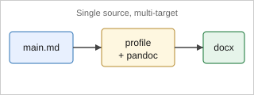

<!--
data/dummy/main.md — テンプレート自己検証用の最小原稿 (完結サンプル)

build / diff / package パイプラインを通すための「全要素入り」ダミー論文。
.development マーカーがあると build.sh / diff.sh はこの data/dummy/ を入力ルートにする (docs/architecture.md §4)。

【内容は明らかなフィクション】
  data/dummy/bhi/ と同じ TJD/THS のパロディ (出典は https://github.com/fk506cni/jami-pandoc-public)。
  著者名も所属も架空である (実在しそうな体裁のダミーは、本番原稿に混じったときに気づきにくい)。
  **パイプラインに通す要素** —
  図 3 枚 (手書き SVG / PDF 由来 / Mermaid) / 数式 / pipe 表 / .grid 表 / .textbox 内の表 /
  インライン数式 / 箇条書き / 引用 2 件 + 未引用 1 件。

【重要】タイトル / 著者 / 所属 / 抄録 / キーワードは YAML メタではなく custom-style Div で書く。
これにより構造保持 AST 差分 (step03) がこれらを温存し、内部を語単位で差分化できる (CLAUDE.md / docs/architecture.md §2.3)。
YAML メタに置くと差分対象にならない。

図参照は CJK でも安全な角括弧形式: [@fig:overview] / [@tbl:cohort]。
-->

::: {custom-style="Title"}
A Measurement Pipeline for the Tremendous Hunch, from Apparatus to Reported Score
:::

::: {custom-style="Author"}
Taro Yokan^1^, Hanako Chokkan^1,2^, Bonta Dan^2^
:::

::: {custom-style="Affiliation"}
^1^Graduate School of Hunch Engineering, University of the Tremendous, Tremendo, Fictionia
^2^Department of Intuition Informatics, Vibes Research Institute, Vibeston, Fictionia
:::

::: {custom-style="Abstract"}
**Background:** The tremendous hunch has never been measured, and the few accounts that exist
were gathered informally. We describe the measurement pipeline that turns a single trial into a
reported score, from the apparatus to the number printed on the display.

**Methods:** The pipeline logs three quantities per trial, combines them into one dimensional
score, and records both the inputs and the combination so that a trial can be recomputed later
[@dan2099].

**Results:** Twenty trials across three interaction conditions produced a consistent ordering
of the conditions. The recomputation of every trial from the stored inputs reproduced the
reported score exactly.

**Conclusions:** Keeping the inputs and the combination rule separate makes a composite score
auditable, which matters more than the score itself [@chokkan2100].
:::

::: {custom-style="Keywords"}
**Keywords:** intuition; psychophysics; apparatus design; reproducible measurement; composite score
:::

# Introduction

A composite score that mixes instrumented and human-scored quantities is easy to compute and
hard to trust. When the score moves, nobody can say which input moved it, because the inputs
are not kept. This pipeline stores every input alongside the rule that combined them, so a
trial can be recomputed months later without the apparatus [@chokkan2100].

An overview of the measurement workflow is shown in [@fig:overview]. The processing stages are
summarized in [@fig:pipeline], and the architecture of the recording software in [@fig:arch].

{#fig:overview}

{#fig:pipeline}

{#fig:arch}

# Methods

## Combination rule

The score combines hunch intensity, cold-sweat volume, and the supervising professor's degree
of exasperation. Exasperation sits in the denominator and is squared, so that an unmoved
supervisor makes any hunch look tremendous — a property we wanted visible in the formula rather
than buried in the discussion [@dan2099].

The propagated error scales with the number of scored inputs as shown in equation [@eq:size]:

$$ S = \alpha \cdot n + \beta \log n $$ {#eq:size}

where $n$ is the number of human-scored inputs and $\alpha, \beta$ are constants.

## Conditions

Three interaction conditions were used. Their characteristics are listed in [@tbl:cohort].
The default booktabs (three-line) rule style is applied automatically.

| Condition     | Instruction to the subject | Trials | Scoring     |
|:--------------|:---------------------------|:-------|:------------|
| Staring       | look at the apparatus      | 12     | per trial   |
| Gentle touch  | rest one hand on the body  | 5      | per trial   |
| Looking away  | face away and think        | 3      | per trial   |

: Interaction conditions and their characteristics. {#tbl:cohort}

When every cell border is required (for example, a checklist), wrap the table in a `.grid` Div so the
post-processor applies full borders instead of booktabs:

::: {.grid}
| Item                  | Status |
|:----------------------|:------:|
| Inputs stored         | yes    |
| Rule stored           | yes    |
| Trial recomputed      | yes    |
:::

# Results

All twenty trials were recomputed from the stored inputs and reproduced the reported score.
The floating summary box below is placed with a `.textbox` Div; it contains its own table so that
the diff path can be checked for text-box–internal cells (a region prior tooling could not diff).

::: {.textbox width="80mm" height="45mm" pos-x="20mm" pos-y="55mm" page="1" valign="top"}
**Summary box (floating).**

| Metric              | Value |
|:--------------------|------:|
| Trials recorded     | 20    |
| Mismatches on recompute | 0 |
:::

The inline math $r = 0.92$ and the cross-reference to [@tbl:cohort] both survive the diff path as
preserved elements.

# Discussion

Storing the inputs and the combination rule separately is what makes the score auditable; the
ordering it produces is secondary. The main known limitations are:

- The exasperation term is scored by a listener, so it carries whatever that listener carries.
- Trials are not balanced across conditions, because the count follows the subject's preference.
- A recomputed score agrees with the reported one by construction, so agreement is not evidence
  that either is correct.

Further details are documented in the design notes [@dan2099].

# References

::: {#refs}
:::
