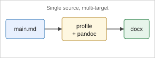
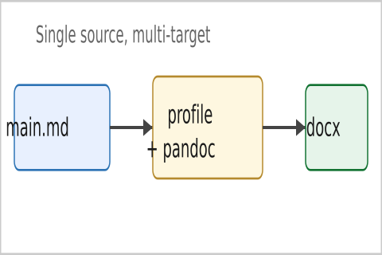
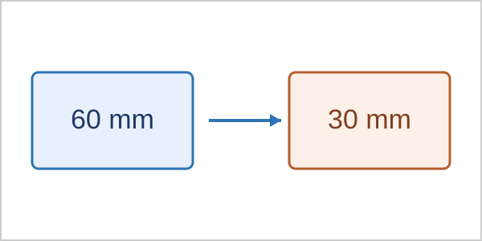
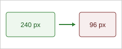

<!--
data/dummy/regression/main.md — 回帰フィクスチャ

実投稿原稿に近い構成で「図番号が一致する・図が壊れて消えない」ことを、
最小ダミー (data/dummy/main.md) では踏めない死角で確かめるためのフィクスチャ:
  (1) PNG 図を本文から直接参照 (figs/fig-photo.png)           … step01 のラスタ複製・図番号の一致
  (2) 1 段落に 2 図 (ID 無しの 2 image)                        … 段落内の全図の除去
  (3) テキストボックス内に図 (.textbox Div 内の image)         … 温存されるべき
  (4) 著者ブロックに連絡先メール                               … 文献数の誤計数防止
  (5) 物理単位 (mm) / px 単位を持つ SVG                        … 300dpi 保証の換算経路
      figs/fig-scale-mm.svg = 60x30mm → 300dpi で 709x355 px
      figs/fig-scale-px.svg = 240x96px → 300dpi で 750x300 px (px を換算しないと 240x96 px のまま)
      検算は `bash scripts/check-figures.sh --tree data/step01_figures/figs`
  (6) テキストボックス内の Legend / テキストボックス内の表      … 末尾への集約・移設の対象外
      本文の表 (tbl:relocate) とその凡例は末尾へ移り、箱の中の表と Legend は動かない。
      確認は `bash scripts/package.sh --journal bhi --input data/dummy/regression --mode final --format png`
  (7) SVG の連結に起因する崩れ (合成。**本文からは参照しない**)  … check-figures の「注意」
      figs/fig-svglite-twice.svg = `<g class='svglite'>` が 2 つ (Word が文字を片方のパネルへ寄せる条件)
      figs/fig-dup-clip-id.svg   = clipPath の id が重複 (切り取りの取り違え)
      どちらも図ツリーには載る (図前処理は figs/ の全 SVG を処理する) ので、
      `bash scripts/build.sh --input data/dummy/regression` の後の `bash scripts/check-figures.sh` で
      注意が 2 件出る。本文から参照しないのは docx の出力を変えないため
  (8) Word / PowerPoint で黒く塗られる hsl() の色 (合成。**本文からは参照しない**)
      figs/fig-hsl-fill.svg       = 塗りが hsl() (CSS と fill 属性) → check-figures で注意 1 件
      figs/mermaid/flow-theme.mmd = テーマの色を変えた Mermaid (サブグラフ・辺のラベル)。convert.sh の
                                    後処理が hsl() を 16 進に直すので**注意は出ない**のが正しい
      (7) と合わせて、`check-figures.sh` の Word / PowerPoint 向けの注意は 3 件になる

注意: pandoc-crossref で番号を振る図 ({#fig:...}) は「1 段落 1 図」で書くこと。1 段落に複数の番号付き図を
      置くと crossref が図として扱わず Undefined cross-reference になる (CLAUDE.md の「原稿執筆の規約」)。番号不要の
      装飾画像は同一段落に複数置いてよい (下の Methods 段落がその例)。

注意: 本フィクスチャは **BHI の適合原稿ではない** (Title page の連絡著者ブロックも
      Declarations 節も持たない)。したがって `--journal bhi` で回すと validate が
      「Declarations 節が無い」「連絡著者ブロックが無い」等を正しく指摘する。**これは不具合ではない** —
      本ファイルの目的は図の経路と末尾移設の対象の切り分けを踏むことにあり、BHI の原稿要件を
      満たすことではない。BHI 規定に適合した見本は data/dummy/bhi/、わざと違反させた lint 用の
      フィクスチャは data/dummy/bhi-lint/ にある。

使い方:
  bash scripts/build.sh   --input data/dummy/regression
  bash scripts/package.sh --input data/dummy/regression --journal _default --mode final
-->

::: {custom-style="Title"}
Regression Fixture: PNG Figures, Multi-Image Paragraphs, and Text-Box Figures
:::

::: {custom-style="Author"}
Hanako Yamada^1^, Taro Suzuki^1,2^

Correspondence: hanako.yamada@med-info.example.com
:::

::: {custom-style="Affiliation"}
^1^Department of Medical Informatics, Example University Hospital, Example City, Japan
^2^Graduate School of Medicine, Example University, Example City, Japan
:::

::: {custom-style="Abstract"}
**Background:** This fixture exercises figure handling that the minimal dummy did not cover.

**Methods:** It references a raster PNG figure directly, places decorative images in one paragraph, and
embeds a figure inside a floating text box, while citing prior work [@smith2020; @tanaka2019].

**Results:** Final-mode packaging keeps the numbered body figures aligned with the separated figure files,
and the text-box figure is preserved rather than stripped [@saito2021].

**Conclusions:** Realistic figure constructs survive the final-mode separation path.
:::

::: {custom-style="Keywords"}
**Keywords:** regression; figures; text box; packaging
:::

# Introduction

A vector overview figure opens the manuscript in its own paragraph [@fig:overview].

{#fig:overview}

A pipeline figure derived from a PDF source follows [@fig:pipeline].

{#fig:pipeline}

A photograph supplied directly as a raster PNG is referenced next [@fig:photo].

{#fig:photo}

Two scale fixtures follow. The first declares its size in millimetres [@fig:scalemm], the second in CSS
pixels [@fig:scalepx]; both must reach the requested raster resolution.

{#fig:scalemm}

{#fig:scalepx}

# Methods

The paragraph below holds **two decorative images side by side** (no figure numbers); final-mode stripping
must remove both from this single paragraph, not only the first.

 

# Results

The floating box below contains its own image. Because it sits inside a `.textbox` Div, the final-mode
figure separation must **preserve** it (not replace it with a placeholder). The box also carries its own
`Legend` block, which the legend aggregation must **not** pull out into the Figure Legends section.

::: {.textbox width="70mm" height="45mm" pos-x="20mm" pos-y="60mm" page="1" valign="top"}
**Inset (floating).**

::: {custom-style="Legend"}
Legend inside a floating text box. It must stay in the box.
:::
:::

A body table follows so that the table relocation can be checked against a text box that also
contains one. The body table moves to the end; the one inside the box below does not.

: Body table used to check the table relocation. {#tbl:relocate}

| Region        | Moved to the end |
|:--------------|:-----------------|
| Body flow     | yes              |
| Inside a box  | no               |

::: {custom-style="Legend" for="tbl:relocate"}
Legend of the body table. It must travel with its table.
:::

::: {.textbox width="70mm" height="30mm" pos-x="110mm" pos-y="60mm" page="1" valign="top"}
**Boxed table (floating).**

| Metric | Value |
|:-------|------:|
| Rows   | 1     |
:::

The contact email in the author block (`hanako.yamada@med-info.example.com`) must not be miscounted as a
reference [@saito2021].

# References

::: {#refs}
:::
